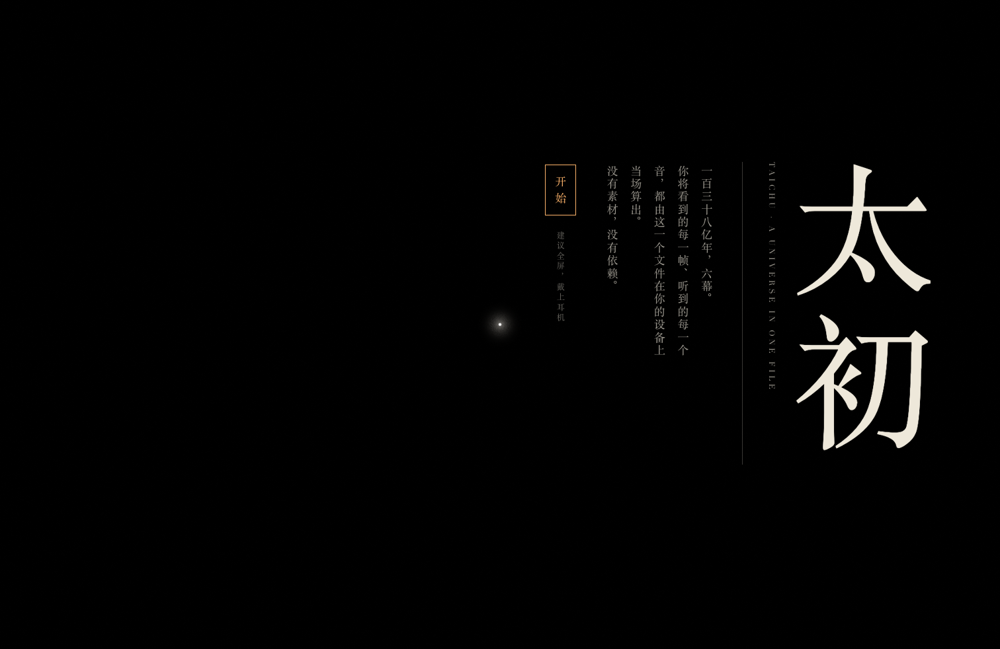
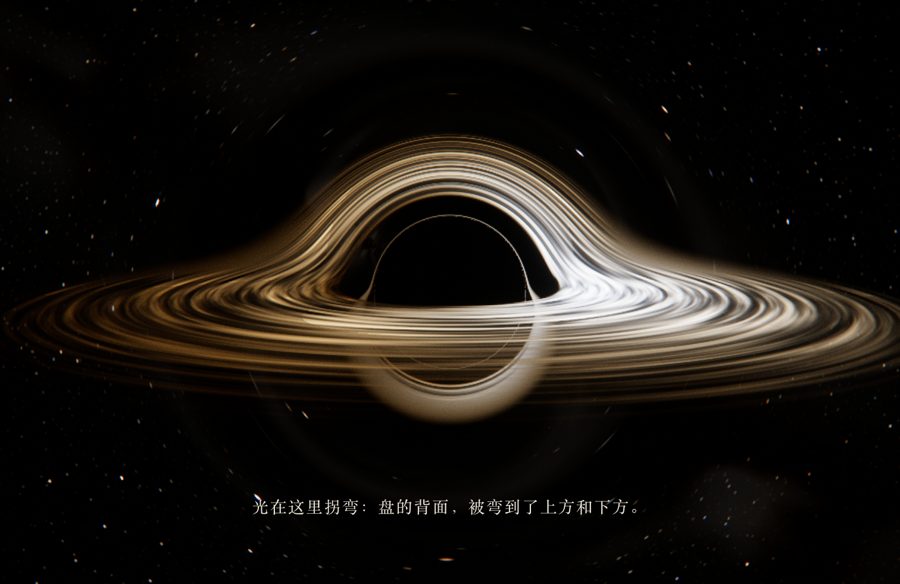

# 太初 · TAICHU

一个文件里的宇宙：从奇点到语言，六幕实时物理模拟，配乐当场合成。

单个 HTML 文件（约 340 KB），零素材、零依赖、零外部请求。你看到的每一帧、听到的每一个音，都由这个文件在你的设备上当场算出。



## 六幕

| 幕 | 在算什么 |
|---|---|
| 奇点 | 两百万个质点按泽尔多维奇近似 `x = q − D(t)·∇Φ(q)` 在顶点着色器里当场求位置，冷却后编织成宇宙网 |
| 星系 | 一百万颗恒星的受限 N 体模拟（图姆尔兄弟 1972），两个星系相遇、甩出潮汐尾、并合 |
| 视界 | 每个像素在史瓦西时空里积分一条零测地线；光子环、盘的背面像、多普勒增亮都是积分结果 |
| 蔚蓝 | 岩浆行星冷却成海；瑞利 + 米氏 + 臭氧单次散射，系数取地球大气实测值 |
| 生命 | 格雷–斯科特反应扩散，斑点自我复制、分化成迷宫与珊瑚；可拖动播种 |
| 言 | 一百万个阻尼弹簧粒子写出文字；最后你输入的话也由粒子写出 |

按 **I** 打开「解剖」面板：每一幕的方程、实时数值，以及物理自检（实测值对理论值）。例如黑洞阴影角半径实测 14.278°，辛格公式给出 14.269°。



## 运行

直接用浏览器打开 `dist/taichu-standalone.html`。需要支持 WebGL2 与浮点渲染目标的浏览器；建议全屏、戴耳机。

开发：

```bash
python3 tools/devserver.py          # 然后打开 http://127.0.0.1:8765/dev.html
python3 tools/check.py              # 全片回归：多时间点截图 + 物理自检 + 性能（需要 playwright 与 Chrome）
python3 tools/build.py              # 构建 dist/
```

## 结构

- `src/core/` 引擎：WebGL2 助手、共享着色器片段（噪声、黑体色、星空）、后期链路、相机、主循环
- `src/chapters/` 六幕（`0-testcard.js` 是开发用参考章，不进产物）
- `src/ui/` 界面，`src/audio/` 配乐
- `tools/` 截图、回归、构建、配乐频谱检查
- `CONTRACT.md` 共享契约，`briefs/` 各幕任务书，`notes/` 建造过程记录

## 制作

由 Claude 写成：Fable 5.2 负责规划、契约与终审，Opus 5.5 子代理负责各模块的实现与返工。
